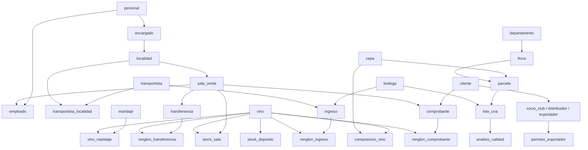

# Informe Etapa 3 - Carga masiva de datos

## 1. Orden de carga (dependencias FK)

Niveles topologicos: 0 personal/bodega/cepa/maridaje/transportista/departamento; 1 encargado/finca; 2 localidad/parcela; 3 sala_venta/transportista_localidad; 4 empleado/vino; 5 composicion/vino_maridaje/cliente; etc.

## 2. Estrategia de triggers

Durante la carga historica se deshabilitaron los triggers de usuario (`ALTER TABLE ... DISABLE TRIGGER USER`) para evitar conflictos con triggers de fecha (CURRENT_DATE) y para mejorar performance. Se insertaron documentos en estado `procesado` con fechas historicas. Los stocks finales se calcularon en memoria y se insertaron al final. Al finalizar se rehabilitaron los triggers (`ENABLE TRIGGER USER`) y se ejecutaron actualizaciones de precio para generar filas en `auditoria_precio`. Riesgos: si los datos no son coherentes, al rehabilitar los triggers las validaciones posteriores fallan; por eso se ejecutan consultas de control.

## 3. Volumenes y tiempos

| Tabla | Filas | Tiempo (s) |
|---|---:|---:|
| departamento | 18 | 0.007 |
| personal | 78 | 0.004 |
| encargado | 18 | 0.003 |
| localidad | 18 | 0.004 |
| sala_venta | 30 | 0.003 |
| empleado | 60 | 0.004 |
| cepa | 12 | 0.002 |
| maridaje | 8 | 0.002 |
| bodega | 20 | 0.003 |
| transportista | 15 | 0.003 |
| transportista_localidad | 40 | 0.003 |
| finca | 40 | 0.003 |
| parcela | 600 | 0.013 |
| vino | 400 | 0.010 |
| composicion_vino | 802 | 0.018 |
| vino_maridaje | 806 | 0.021 |
| cliente | 20000 | 0.282 |
| socio_club | 12000 | 0.110 |
| distribuidor | 5000 | 0.073 |
| exportador | 3000 | 0.035 |
| permiso_exportador | 4500 | 0.062 |
| lote_uva | 1785 | 0.058 |
| analisis_calidad | 1785 | 0.024 |
| ingreso | 2500 | 0.048 |
| renglon_ingreso | 7522 | 0.122 |
| transferencia | 2500 | 0.025 |
| renglon_transferencia | 10005 | 0.158 |
| comprobante | 150000 | 2.592 |
| renglon_comprobante | 600575 | 14.656 |
| stock_deposito | 400 | 0.007 |
| stock_sala | 5426 | 0.084 |
| auditoria_precio | 15 | - |

## 4. Benchmark

- Fila por fila: 5000 filas en 0.635s -> 7874 filas/s; extrapolado 500000 = 63.5s
- Por lotes (COPY): 5000 filas en 0.008s -> 625000 filas/s; extrapolado 500000 = 0.8s

## 5. Validaciones

Resultados de `validacion_carga.sql`: 0 filas huerfanas, 0 stock negativo, 0 comprobantes inconsistentes, 0 vinos con composicion != 100, 0 permisos invalidos, 0 clientes con descuento inconsistente, 0 lotes duplicados.

## 6. Dump

Archivo `db/seed/dump_completo.sql.gz` generado. Restaurar:
`gunzip -c db/seed/dump_completo.sql.gz | psql -U postgres -d bodegas_atuel`
